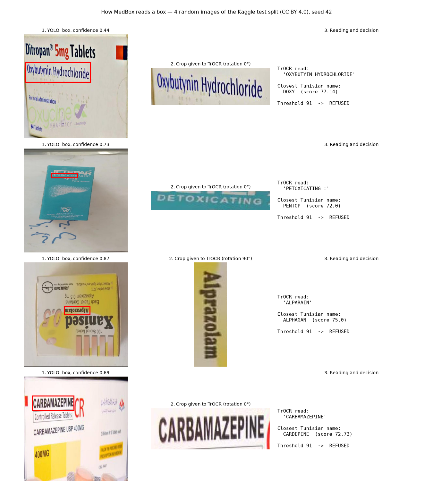
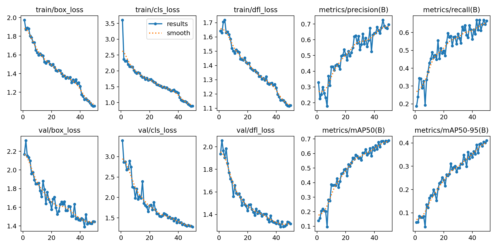
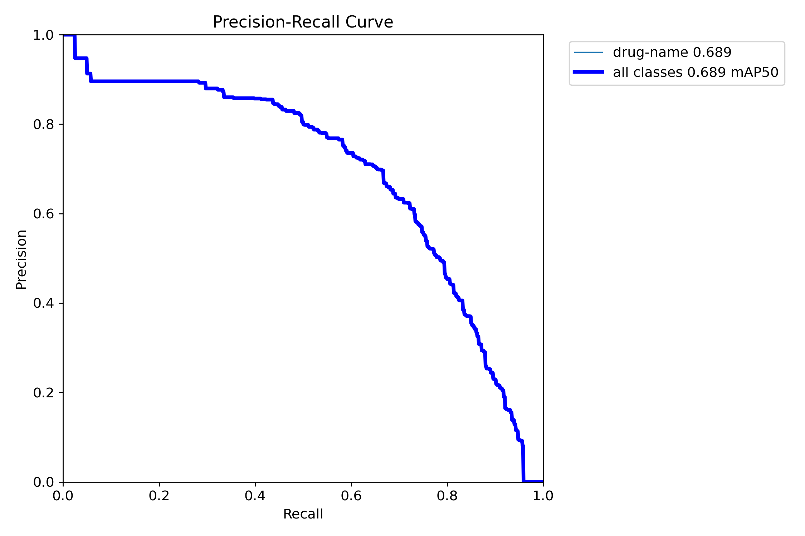
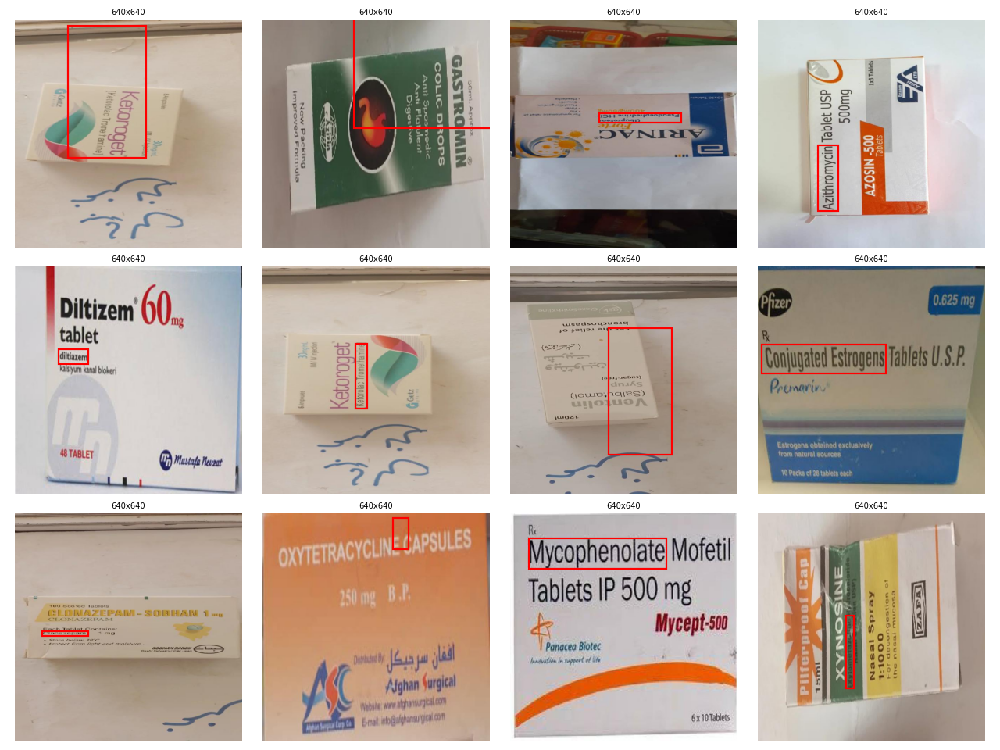

# MedBox Reader

**Prototype: read the trade name of a Tunisian medicine from a photo of its box, or refuse.**
YOLOv8 (PyTorch) finds the drug-name region, TrOCR (Hugging Face) reads it, fuzzy matching compares it with a closed
list of 2,160 Tunisian trade names, and the system **refuses** when the match score is below a threshold.

> ⚠️ Prototype for research and learning. **Not a medical tool.** It does not replace a pharmacist.
> It does not read Arabic, dosage, or prescriptions.

---

## Results in one table

| What was measured | Result | Source |
|---|---|---|
| Detector (YOLOv8n), Kaggle **val** split | mAP@0.5 = **0.690** (used to choose between 2 runs, so slightly optimistic) | `results/yolo/yolo_results.json` |
| Detector, Kaggle **test** split, evaluated **once** | mAP@0.5 = **0.667**, mAP@0.5:0.95 = 0.378 (182 images) | `results/yolo/yolo_results.json` |
| End-to-end, frozen pilot test (14 web-collected images: 9 boxes + 5 non-medicine objects) | **0/9 boxes recognized** (95% CI 0.00–0.30) · **0 wrong accepts** (0/14, 95% CI 0.00–0.22) · **5/5 negatives refused** (95% CI 0.57–1.00) | `results/final_test.json` |
| Baseline without detector (TrOCR on the whole image), same test | 0/9 recognized · 0 wrong accepts · 5/5 negatives refused | `results/final_test.json` |
| **Field test (v1.1), 13 own phone photos** (8 boxes in the list + 5 pharmacy products not in the list), system frozen at v1.0 | Pipeline: **0/8 recognized** (95% CI 0.00–0.32) · **0 wrong accepts** (0/13, 95% CI 0.00–0.23) · **5/5 out-of-list products refused** (95% CI 0.57–1.00) | `results/field_test.json` |
| Baseline, same field photos | 0/8 recognized · **1 wrong accept** (1/13, 95% CI 0.01–0.33) · 5/5 refused | `results/field_test.json` |
| Decision rule "YOLO is useful" | **undefined** on both tests: the pipeline accepted no image, so its top-1 precision has n = 0 | `PROTOCOL.md` §8 |
| Decision rule "demo can be published" (≤ 1 wrong accept) | yes (0 wrong accepts) | `PROTOCOL.md` §8 |

**In plain words:** on 27 test images (web pilot and own phone photos), the full pipeline **never gave a wrong drug
name**, but it also **never recognized a drug**: it refused everything. The baseline without the detector gave one
wrong answer. Below is why, and what this teaches.

---

## Pipeline

```
photo ──► YOLOv8n (drug-name region) ──► crop (+5 %) ──► TrOCR at 0°, 90°, 270° ──► rapidfuzz WRatio vs 2,160 names
                                                                                     │
                                       score ≥ threshold (91) ──► trade name   ◄─────┤
                                       score < threshold or no box ──► REFUSED ◄─────┘
Baseline: the same, without YOLO (TrOCR reads the whole image).
```

| Component | Why |
|---|---|
| **YOLOv8n** (Ultralytics, PyTorch), fine-tuned on Kaggle | A box has a lot of text; the detector should isolate the name line. |
| **TrOCR** `microsoft/trocr-base-printed` (Hugging Face), used as is | Encoder–decoder (ViT + Transformer) trained on printed text lines. |
| **rapidfuzz** WRatio + closed list | Corrects OCR errors against known names only. |
| **Refusal threshold** chosen on dev images only | A confident wrong answer is worse than a refusal. |

---

## How detection works

**Detection vs OCR.** OCR reads text; it does not know *which* text on a box is the drug name. A medicine box has
many lines (brand, molecule, dosage, laboratory, warnings). The detector's job is to find **where** the name is,
so that TrOCR reads one line only.

**What YOLOv8 does, step by step:**

1. The photo is resized to 640 × 640 px (with grey bands to keep the ratio: "letterbox").
2. A convolutional network (CSP backbone + feature pyramid) looks at the image **once** ("You Only Look Once") and,
   at three scales, predicts for many positions: a box (x, y, width, height) and a confidence that it contains a
   `drug-name`. YOLOv8 is *anchor-free*: it predicts the box directly, without predefined box shapes.
3. Boxes below confidence 0.25 are dropped; overlapping boxes are merged by **non-maximum suppression** (NMS).
4. MedBox keeps the **single most confident box**, enlarges it by 5 % on each side (so edge letters are not cut),
   and crops it.
5. TrOCR reads the crop at 0°, 90° and 270° (21 % of the training name boxes are vertical), and the reading with the
   best match score is kept. Below the threshold (91), the answer is a refusal.

**Example on 4 random images of the Kaggle test split** (CC BY 4.0, seed 42 — not hand-picked, not our frozen test;
these boxes are not Tunisian, so most names are not in the Tunisian list and a refusal is the expected answer):



What this random sample shows: the detector finds a box on all 4 images, and TrOCR reads well when the crop is large
(`CARBAMAZEPINE` exactly, `OXYBUTYIN HYDROCHLORIDE` almost). But on 3 of the 4 boxes, the detector framed the
**molecule** (Oxybutynin, Alprazolam, Carbamazepine) and not the **brand** printed bigger on the same box
(Ditropan, Xanised): the same label bias as in the error analysis. Row 3 also shows a limit of the rotation rule:
the text is upside down (180°), a rotation MedBox does not try (only 0°, 90°, 270°).

**Training of the detector** (run B, 50 epochs on 1,276 images; Kaggle T4, 13.2 min):

| Training curves (losses go down, mAP goes up) | Precision–recall curve (val) |
|---|---|
|  |  |

Training images with their labels (Kaggle/Roboflow, CC BY 4.0) — note the vertical names and the boxes on generic
names (e.g. "Mycophenolate" instead of the brand), which explain part of the errors below:



---

## Error analysis (test, pipeline, 9 boxes)

| Error type | Count | Images | What happened |
|---|---|---|---|
| Detector found no name region | 3 | t03, t04, t06 | Images are tiny (see below); after upscaling to 640 px the text is blurry. |
| Detector picked the **generic name** (DCI), not the brand | 2 | t01, t09 | t01: TrOCR read `DOMPERIDONE` perfectly (Motilium's molecule) → closest brand `DOMPER` (score 90, refused). t09: read `DISMETITE` (diosmectite) → `SMECTITE` (82, refused). |
| OCR produced unrelated text | 4 | t02, t05, t07, t08 | Readings like `1` or `AMOUNT` on crops of a few dozen pixels. |

Non-medicine objects: 5/5 refused (one was read as `-JABON NATURAL-` → `XATRAL`, score 75, refused).

No threshold would have helped: on the test set, **no candidate name was correct** for any box, in the pipeline or in
the baseline (`candidate` field in `results/final_test.json`). A lower threshold would only have added wrong answers.

### Why it failed (findings)

1. **Tiny test images.** The test images are web images and screenshots, not phone photos. Median size of the 9 box
   images: **245 × 182 px** (a phone photo is about 4000 × 3000 px). Only t01 is large (2000 × 2000).
2. **The training labels mix brand and generic names.** In the Kaggle/Roboflow dataset, some boxes are labelled on the
   generic name line (e.g. "Mycophenolate" instead of the brand "Mycept"). The detector learned this, and on t01 and t09
   it cropped the generic name. Matching a generic name against a list of brands produces a *different* brand —
   exactly the dangerous case. The threshold refused it.
3. **WRatio gives 90 to any fragment.** If the OCR text is a short piece of a longer name (`TAX` in `KETAXOL`),
   WRatio's partial match scores 100 × 0.9 = **90**. The dev rule (smallest threshold with 0 wrong accepts) gave
   **91**, just above this artifact. This is why the baseline, which mostly reads fragments, never got accepted.
4. **TrOCR reads one line.** On a whole box (baseline), it outputs a short fragment of one line.

### What I would change next (decided before any new test)

- Re-train the detector on brand-name boxes (the field test shows this is the main blocker).
- Refuse OCR readings shorter than 4 characters, before matching.
- Match against **brand and generic names** (the list has a DCI column), and answer "generic name X" instead of guessing a brand.
- Re-label the detector data to mark the brand line only; or detect the whole box first, then the name.
- Also try a 180° rotation (upside-down text seen in the README figure).

---

## Version 2 — development results (not a test yet)

**Why a v2:** the v1 analyses showed that TrOCR reads well but YOLO looks at the wrong place (generic name, or nothing),
and that on all own photos the **brand is the largest text** on the box. v2 was designed from this, with its rules
committed before any v2 code (`PROTOCOL.md` §11, commit `ff1cdf3`; code `d635872`).

```
photo ──► CRAFT text detector (EasyOCR) ──► 5 tallest text lines ──► TrOCR at 0°/90°/180°/270°
      ──► drop readings < 4 characters ──► rapidfuzz ratio vs 2,160 trade names AND 728 generic names (DCI)
      ──► trade name (score ≥ 88) │ "molecule X, brand not identified" (score ≥ 72) │ REFUSED
```

**Development results on the 13 own photos** (the v2 thresholds were **chosen on these same photos**, so these numbers
are optimistic and are **not** a test; `results/dev_v2.json`):

| | v1 (YOLO), same photos | v2 (development) |
|---|---|---|
| Correct trade name | 0/8 | **6/8** (95% CI 0.41–0.93) |
| Correct trade name **or** correct molecule | 0/8 | **7/8** (95% CI 0.53–0.98) |
| Wrong answers | 0/13 | **0/13** (95% CI 0.00–0.23) |
| Products not in the list refused | 5/5 | **5/5** |

Per photo: Clamoxyl, Smecta, Allergica, Belifax, Maxilase, Inflamyl → correct trade name (score 100).
Urpex → "molecule ACICLOVIR, brand not identified" (the brand was not among the readings; the molecule is correct).
Uciderm Plus → refused (only `PLUS` was read). The 5 products not in the list were refused.

**Honest caveat:** `T_brand = 88` sits just above one negative: Respiwell was read `ALLERIA`, which scores 87.5 against
`ALLERGICA`. With so few dev photos, the margin is thin. Only a new test on **unseen photos** (≥ 20 new boxes,
`PROTOCOL.md` §11) can say whether v2 really generalizes. Until then, these are development numbers.

---

## Field test on own phone photos (v1.1)

Added after v1.0, with rules committed before the run (`PROTOCOL.md` §10, commits `e60bcaa` and `6a522b0`).
13 photos taken with my phone at home (boxes held in the hand, fridge light), sent through WhatsApp (900 × 1600 px).
The system was **not changed**: same weights, same list, same threshold 91. Run once (`python -m medbox.evaluate --field`).
3 more photos were excluded by the rules written before the run (2 names printed only in Arabic, 1 ambiguous variant).

| Photo | Truth | Pipeline: what happened |
|---|---|---|
| 5 of 8 boxes (Clamoxyl, Uciderm Plus, Allergica, Maxilase, Inflamyl) | in the list | **no box detected** → refused |
| Smecta | SMECTA | box on the **generic name line**, read `PLOSMECUTE 3 9-LON BUVEBLE` (= "diosmectite 3 g … buvable") → refused |
| Urpex | URPEX | box on the **generic name line**, read `ACICLOVIR 6%` → closest name `ACICLOVIR OPALIA` (another laboratory's product), score 90 → **refused** |
| Belifax | BELIFAX | box on the **generic name line**, read `OMERVABWO` (≈ "omeprazole") → refused |
| 5 products not in the list | NONE | 5/5 refused (4 no detection, 1 read `ANGING OPEND NO.` → score 75) |

**What the field test confirms (now on real photos):**

1. **The label bias is the main failure.** When the detector finds a box (3 of 8 boxes), it is **always the generic
   name line**, never the brand. On Urpex, OCR read the molecule correctly and the closest list entry was a product of
   another laboratory: a lower threshold (90) would have produced a **confident wrong medicine**. The refusal rule stopped it.
2. **Larger images were not enough.** The photos are about 20 times larger than the web pilot images, but the detector
   still found no name region on 5 of 8 boxes. Probable causes (not measured): brand names in large stylized fonts
   that differ from the training labels, and boxes photographed at an angle in the hand.
3. **The detector protects against fragments.** Without it (baseline), TrOCR reads short pieces of the whole box
   (`TAX`, `PAX`, `MAR`) that score exactly 90. One reading was the single letter `T`, which is a real trade name in the
   list (`T`): the short-name rule only allows an exact match, and this *was* an exact match → **1 wrong accept**
   (Allergica answered as "T"). Lesson: refuse OCR readings shorter than 4 characters, before matching.

---

## Demo example (not part of the test)

On a larger, sharper web image of a box labelled "Metformin" (not in the test set), the full pipeline worked
mechanically: YOLO found the name line, TrOCR read `METFORMIN` exactly, and the closest list entry was
`METFORMINE SANOFI` (score 90). The system **refused**: "Metformin" is the molecule, and naming a specific
product from another laboratory would be a confident wrong answer. Screenshot not included (image not owned).

---

## Evaluation protocol (pre-registered)

The rules were written in [`PROTOCOL.md`](PROTOCOL.md) and committed **before** each result they govern.
Key commits (`git log --oneline` shows the full order):

| Commit | What it fixed in advance |
|---|---|
| `9f5662b` | Initial protocol: metrics, refusal rule, single final run, decision rules |
| `702180f` | Kaggle leakage rule and single evaluation on the Kaggle test split (before the data audit) |
| `8da3a85` | OCR rotation rule (from the Kaggle audit, before any OCR code) |
| `967ba2a` | Closed list switched to Pharma Tunisie (before checking which boxes it contains) |
| `8e3a28d` | Random dev/test split (seed 42) |
| `b50fa45` | Deviation 2: web-collected images (see below) |
| `4133f68` | Test set frozen with SHA-256 manifest |
| `0d918dc` | Reader and evaluation code |
| `3a35c59` | Threshold 91 chosen on dev |
| `7253798` | Final test run, executed once (`results/final_test.json`) |
| `e60bcaa` | Field test rules (§10): own phone photos, system frozen at v1.0 |
| `6a522b0` | Field test set frozen (SHA-256 manifest) |
| `ff1cdf3` | v2 design (§11), before any v2 code |
| `d635872` | v2 code, before any v2 run |

The final run (`python -m medbox.evaluate --final`) checks the SHA-256 manifest first and refuses to run twice.

### Deviations (all written before the results they affect)

1. **Fewer boxes than planned:** 12 eligible boxes instead of 30+ → dev 3 boxes + 2 negatives, test 9 boxes + 5 negatives. Pilot scale.
2. **No own photos in v1.0.** The dev/test images were collected from the web or are screenshots (checked with EXIF:
   none comes from the author's phone). Own phone photos were added afterwards as a separate field test (v1.1, above). They are cleaner and much smaller than real phone photos, so the end-to-end result
   is **not representative of real use**. They are **not redistributed** (copyright); only their SHA-256 hashes and the
   ground truth are in this repository.
3. **Closed list changed** from the Kaggle list (1,639 names, about two years old) to the more recent and complete
   Pharma Tunisie list (2,160 names), before checking the boxes.
4. **First data audit was wrong** on 14 % of the labels (polygons read as boxes). A corrected audit gives 21 % vertical
   name boxes. Training was not affected (Ultralytics converts polygons to boxes).

---

## Data and licences

| Data | Use | Licence |
|---|---|---|
| [Drug Name Detection](https://www.kaggle.com/datasets/pkdarabi/the-drug-name-detection-dataset) (P. Karimi Darabi; origin Roboflow, Kabul University) — 1,823 images | Train YOLO | CC BY 4.0 |
| [Pharma Tunisie](https://github.com/ballouchi/medoc) `js/latest.json` @ `b03f9d9` — 4,127 rows → 2,160 trade names | Closed list | Apache 2.0 |
| Web-collected test images | Pilot test (local only) | Not redistributed |

Details, hashes and sources considered but not used: [`data/SOURCES.md`](data/SOURCES.md).
The weights `weights/best.pt` are trained on CC BY 4.0 data (attribution above).

---

## Reproduce

```bash
conda create -n medbox python=3.11 -y && conda activate medbox
pip install -r requirements.txt
python -m pytest -q                      # 11 tests, fake models, < 1 s
python -m tools.fetch_data               # drug list (checks SHA-256); needs a Kaggle key in ~/.kaggle
python -m tools.build_drug_list          # -> data/drugs_tn.csv (2,160 names)
python app.py                            # local demo (Gradio)
```

YOLO training: [`notebooks/train_yolo_kaggle.ipynb`](notebooks/train_yolo_kaggle.ipynb) (Kaggle T4, outputs included).
The dev/test evaluation needs the local images, which are not published.

## Limits

Small tests (9 web + 8 own boxes, wide intervals) · own photos compressed by WhatsApp · no Arabic · no dosage · closed list ·
detector trained on non-Tunisian data · TrOCR not fine-tuned.

## Licence

AGPL-3.0 (compatible with Ultralytics). Author: Abd Elmouhib Souri.
